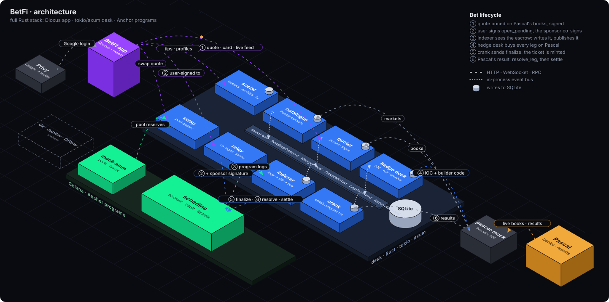

# BetFi

A parlay sportsbook on Solana, priced and hedged on [Pascal](https://pascal.trade)'s prediction
markets.


https://github.com/user-attachments/assets/32b3b001-08b9-439c-b6bd-9447f55277d5


## Architecture



## Highlights

- **pascal-rs**: a Rust SDK for Pascal ([`crates/pascal-rs`](crates/pascal-rs)). It covers the
  read API (REST and WebSocket) and order signing.
- **Hedging**: the math in the code is deliberately naive, enough for the demo. A more serious
  treatment is in [the paper](docs/latex/parlay_hedging.pdf).
- **Hedges are signed, not sent**: every hedge order is signed as a real Pascal order, then filled
  by `pascal-mock` against Pascal's live books. No order reaches Pascal.
- **Swaps**: the DEX aggregator integration is mocked by the `mock-amm` program, which swaps
  test tokens (mockBONK, mockSOL) into mock USDC.

## Devnet programs

| Program | Address |
| --- | --- |
| `schedina` (escrow, vault, tickets) | [`HXdZFi7tR669G1hXogh3uGGqLYsoZPCSuiutAviLNToW`](https://solscan.io/account/HXdZFi7tR669G1hXogh3uGGqLYsoZPCSuiutAviLNToW?cluster=devnet) |
| `mock-amm` (test-token swaps) | [`5WhsDY2XjzJoWDbe1AgJnnNgJccQwte9TgsvG4yRtHbf`](https://solscan.io/account/5WhsDY2XjzJoWDbe1AgJnnNgJccQwte9TgsvG4yRtHbf?cluster=devnet) |

All money on devnet is test money.

## Slides and docs

```sh
just slides   # the presentation on http://localhost:3030 (presenter view at /presenter)
just docs     # the docs/ pages as a book; needs `cargo install mdbook mdbook-katex`
```
