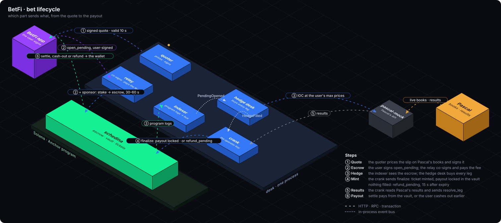

# Bet lifecycle

Drawn by `scripts/lifecycle.py` (`just lifecycle`).

1. **Quote.** The desk prices the slip and signs it. Valid 10 s.
2. **Escrow.** The user signs `open_pending`. The stake (plus the copy fee) moves into the
   program's escrow. It isn't a bet yet. It expires in 30 to 60 s.
3. **Hedge.** The desk re-reads the books and buys the hedge on Pascal at the user's max
   prices. This takes seconds, and prices can move in between: the user signs a floor 3% under
   the quoted total, and each leg's max price is $p_i\,(1.03)^{1/n}$.
4. **Mint or refund.**
   - Hedge filled above the floor: `finalize` mints the ticket and locks the full payout in the
     vault. An unfilled share of the stake is refunded.
   - Hedge failed or the floor broke: nothing is held. Anyone can call `refund_pending` 15 s
     after expiry. Stake and fee come back in full.
5. **Results.** The crank resolves each leg from Pascal's results. A lost leg ends the ticket.
6. **Payout.** `settle` pays the winner from the vault. Or the user cashes out earlier at a
   desk-signed offer.
