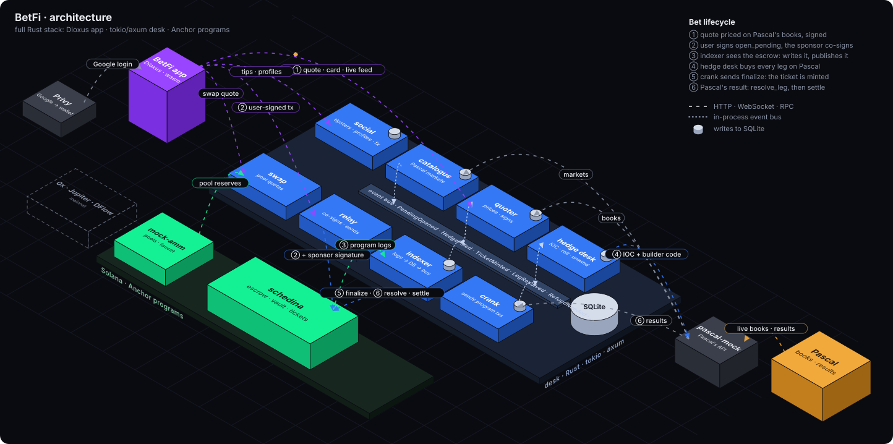

# Tech

Drawn by `scripts/architecture.py` (`just architecture`).

- Only the desk talks to Pascal.
- The app builds and signs every transaction itself. It never trusts the desk with money.
- The program never talks to Pascal. It enforces the floor, the desk's signatures and full
  collateral, whatever the desk does.

Code: `crates/` (backend), `programs/` (on-chain), `app/` (frontend).
