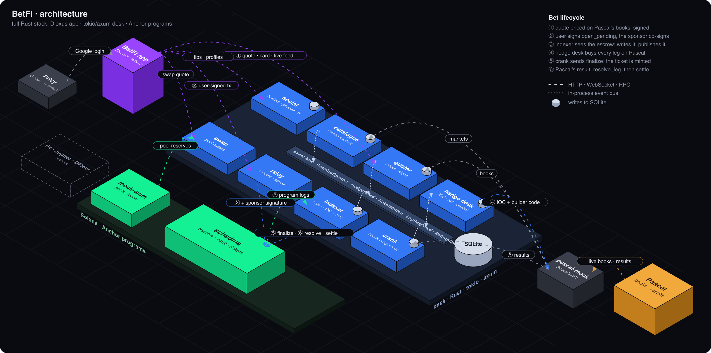

---
theme:
  path: theme.yaml
---

<!-- jump_to_middle -->
<!-- alignment: center -->

<span style="color: #14f195">**BetFi**</span>

<span style="color: #9a9aa3">parlays for everyone · hedged on Pascal</span>

<!--
speaker_note: |
  A sportsbook for traditional bettors. Pascal for prices and hedges, Solana for settlement.
-->

<!-- end_slide -->

Value proposition
===

<!-- alignment: center -->

<span style="color: #9a9aa3">permissionless betting for traditional bettors</span>

<!-- new_lines: 1 -->

**Google login** · <span style="color: #9945ff">account abstraction</span>

**no gas** · <span style="color: #9945ff">sponsored, multi-signed</span>

**any token** · <span style="color: #9945ff">aggregator swap inside the bet</span>

**copy tipsters** · <span style="color: #9945ff">verified stake</span>

**cash out** · <span style="color: #9945ff">mid-game</span>

<!-- new_lines: 2 -->

<!-- column_layout: [1, 1, 1] -->

<!-- column: 0 -->


<!-- column: 1 -->


<!-- column: 2 -->


<!-- reset_layout -->

<!--
speaker_note: |
  - Privy makes the wallet from a Google login.
  - Our sponsor key co-signs as fee payer: the user never holds SOL.
  - Any token: 0x, Jupiter, DFlow route it into the stake (devnet: our mock AMM, Jupiter's shape).
  - Tipsters: record from settled bets they staked themselves; each tip shows the tipster's own
    stake and the copiers' pool.
  - Cash out at a price from the live books.
-->

<!-- end_slide -->

Pascal
===

<!-- alignment: center -->


<!-- new_lines: 1 -->

**price source** · **hedge venue**

<!-- new_lines: 1 -->

<span style="color: #14f195">1 € on n legs ≈ n € traded</span>

<span style="color: #14f195">re-traded every time a leg moves</span>

<span style="color: #14f195">flow that carries no information</span>

<!--
speaker_note: |
  - Every odd comes from Pascal's books; every parlay is hedged leg by leg on Pascal.
  - Volume: each leg's entry hedge is about the stake, so an n-leg parlay trades about n times it.
  - In play, each leg is re-hedged when another leg moves; plus rolls and cash-out unwinds.
  - A trade in leg A is triggered by leg B: makers see it as uninformed flow.
  - New users: bettors who would never open an order book.
-->

<!-- end_slide -->

Full Rust stack
===



<!--
speaker_note: |
  - Desk: catalogue, quoter, hedge desk, crank, relay, indexer, swap, social; SQLite.
  - pascal-mock: Pascal's exact API filling against the live books (Pascal has no devnet).
  - On chain: schedina (escrow, vault, tickets) and mock-amm (pools, faucet).
  - Frontend: Dioxus compiled to wasm; it builds and signs every transaction itself.
-->

<!-- end_slide -->

Hedging · one event
===

<!-- jump_to_middle -->
<!-- alignment: center -->

```latex +render
\[
o(S) = \frac{1-m}{\bar p(S)}
\]
```

<span style="color: #9a9aa3">p̄ = average fill price on the book · m = margin</span>

<!--
speaker_note: |
  Buy the payout in contracts by walking the book: the hedge is exact and model-free. Bigger
  stakes walk deeper, so the odd falls with the stake.
-->

<!-- end_slide -->

Hedging · parlays
===

<!-- jump_to_middle -->

<!-- column_layout: [1, 1] -->

<!-- column: 0 -->

<!-- alignment: center -->

<span style="color: #9945ff">**static superhedge**</span>

```latex +render
\[
C = N \min(p_A, p_B)
\]
```

<span style="color: #9a9aa3">zero risk · very poor odds</span>

<!-- column: 1 -->

<!-- alignment: center -->

<span style="color: #14f195">**live rebalancing**</span>

```latex +render
\[
o^\star = \frac{1-m}{g\big(S\, o^\star\big)}
\]
```

<span style="color: #9a9aa3">E[hedge error] ≥ 0 · λ = risk aversion</span>

<!-- reset_layout -->

<!--
speaker_note: |
  - No market on "all legs win". Static: the Fréchet bound, the odd of the least likely leg.
  - Dynamic programming over live rebalancing; g(N) = all-in cost per unit of payout, with
    a λ·Std premium on the hedge error. The odd is a fixed point (eq. 11), solved by bisection.
  - Two simulated matches, m = 5%: static 2.35, dynamic 3.76 (λ = 1) to 4.16 (λ = 0.25),
    competitive 4.96.
-->

<!-- end_slide -->

Revenue
===

<!-- jump_to_middle -->
<!-- alignment: center -->

**margin** · <span style="color: #14f195">3% per leg</span>

**cash-out** · <span style="color: #14f195">2%</span>

**copy fee** · <span style="color: #14f195">2%, 80% to the tipster</span>

**risk premium** · <span style="color: #14f195">λ · Std</span>

<!--
speaker_note: |
  - Margin inside the total: 3% per leg, 5% when legs overlap.
  - Example: 10 € on two overlapping legs pays 53.80 €; expected take 0.975 € before about
    0.20 € of Pascal fees.
  - Risk premium: priced into g(N); positive on average, since the expected hedge error is ≥ 0.
-->

<!-- end_slide -->

<!-- jump_to_middle -->
<!-- alignment: center -->

<span style="color: #14f195">**BetFi**</span>

<span style="color: #9a9aa3">thank you</span>
